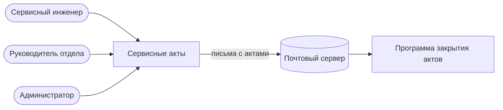
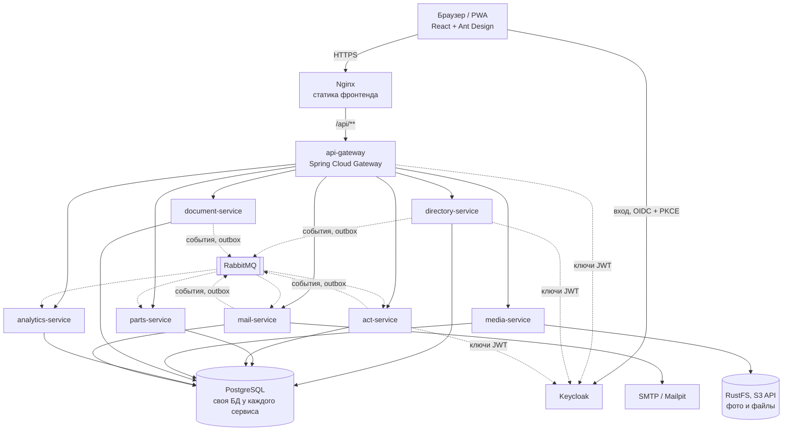
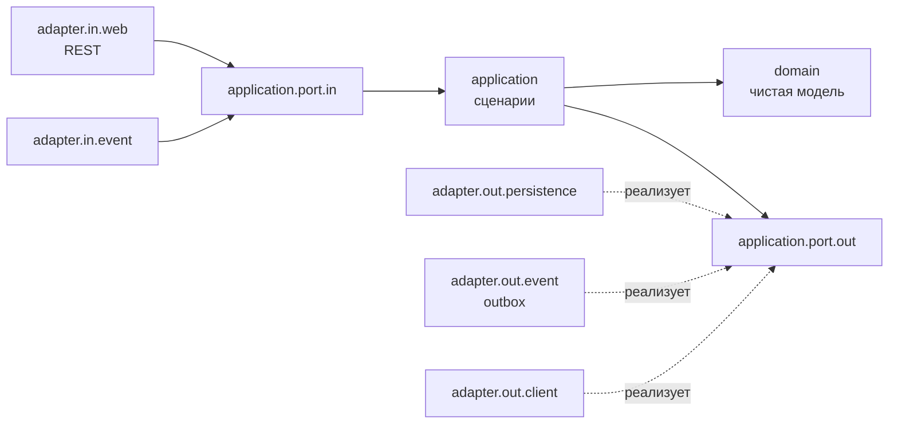

# Архитектура

Подробное описание — в разделе 4 `SPEC.md`, решения — в `docs/adr/`. Здесь — схемы текущего состояния.

## Контекст (C4, уровень 1)

## Контейнеры (C4, уровень 2)

## Устройство сервиса

Стрелки — направление зависимостей. Домен ни от чего не зависит; адаптеры зависят от портов, а не наоборот. Проверяется ArchUnit.
